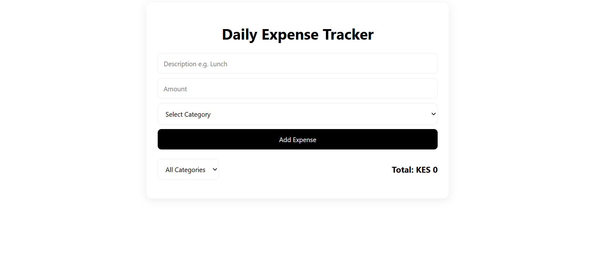

# Daily Expense Tracker

A website that allows users to track their daily expenditure.

**Live Url:** https://david-mwonge123.github.io/expense_tracker/

## Features

The user can be able to:

- Add expenses
- View their expenses
- Delete their expenses
- Filter the expenses by category
  The total expenses are calculated & Local storage persistence.

## Technologies Used

- HTML
- CSS
- Javascript
- GitHub

## How to run locally on your computer

Clone the repo - '''bash git clone https://github.com/David-Mwonge123/expense_tracker
Go into the project folder cd expense_tracker
Open in VS Code code .
Open with Live Server -Install Live Server extension in VS Code -Right-click index.html>Open with live server -Or just double-click index.html in file explorer.

## How to Deploy to Github pages

### First time Setup

Create repo on github named 'expense_tracker'
In your project folder terminal: git init git add . git commit -m "Initial commit - Expense Tracker git branch -M main git remote add origin https://github.com/David-Mwonge123/expense_tracker git push -u origin main
Go to github.com > your repo > settings > pages
Under build and deployment: -Source: Deploy from a branch -Branch: Main/root -Click Save
Wait 1-2 minutes ,refresh, and your link will appear on the top of your page. To Update Changes: -git add . -git commit -m "Add changes" -git push origin main

### Desktop View

### Author
David Mwonge 
Student - Zindua School - Software Engineering